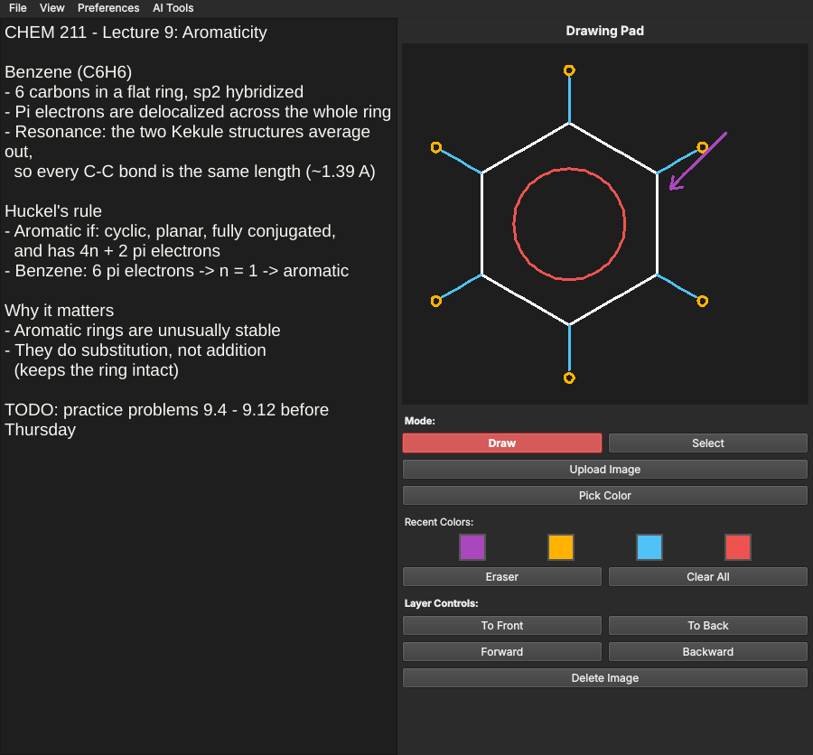
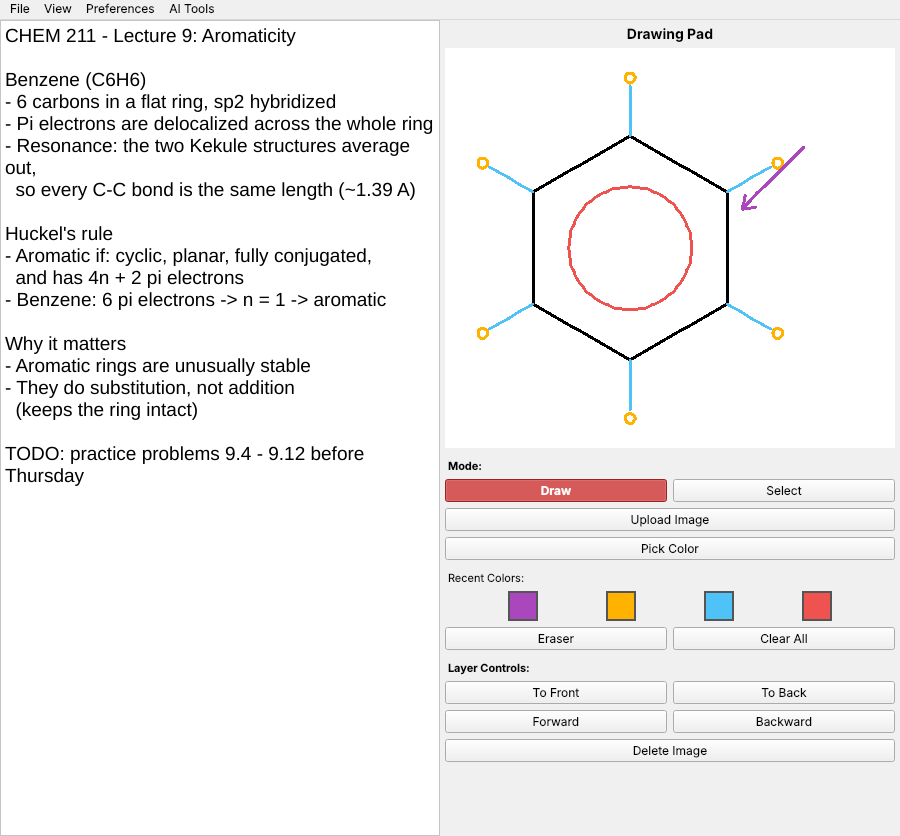
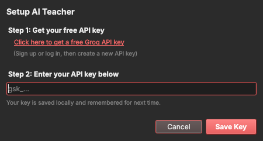

<p align="center">
  
</p>

<h1 align="center">SharkPad</h1>

<p align="center">
  Notes, drawing, and voice dictation in one window. Built for students who need to type, sketch, and listen at the same time.
</p>

<p align="center">
  <a href="https://sharkpad.net"><b>Download at sharkpad.net</b></a>
  &nbsp;·&nbsp;
  <a href="https://github.com/GabeyShark7/sharkpad/releases">Releases</a>
  &nbsp;·&nbsp;
  <a href="#run-from-source">Run from source</a>
</p>

<p align="center">
  
</p>

## Why SharkPad

Some lectures don't fit in a text box. In organic chemistry you're writing notes, drawing structures, and trying to catch what the professor just said, all at once. Most note apps make you switch between tools to do that. SharkPad puts a text editor, a drawing pad, and live voice dictation side by side, so nothing gets missed.

## Features

**Write**
- Google Docs-style autocorrect: obvious typos (teh, liek, dont) fix themselves as you type and flash red, and `Ctrl+Z` right after keeps what you typed
- Spell check with the best suggestion first, and a personal dictionary that's remembered
- Full undo and redo (`Ctrl+Z`, `Ctrl+Y` or `Ctrl+Shift+Z`), find and replace, duplicate and move lines, and one-key date stamps
- Word count, character count, and reading time in the status bar
- Every save goes in its own folder: name it once and get `Name/Name_notes.txt` and `Name/Name_img.png`
- Choose the file types in **Preferences > Save File Types** (notes: .txt, .md, .html; drawing: .png, .jpg, .bmp, .webp, .tiff)
- **Autosave** checkboxes on the notes and the drawing pad save every change automatically
- Line numbers, recent files, print, and export to PDF
- Asks before you lose unsaved changes, and keeps a crash-recovery backup every 30 seconds

**Draw**
- Pen, highlighter, eraser and text tools on a clean icon toolbar, with a color palette and size slider
- Type text anywhere on the pad and double-click to edit it later
- Drag a box to select strokes, text and images together, then move, resize, recolor, copy, duplicate, layer or delete them
- The eraser cuts through strokes, and every change can be undone
- Drawings saved as .png or .jpg reopen fully editable

**Listen**
- Voice dictation that types into your notes as you talk
- Runs locally on your computer with Whisper, so it works offline
- Pick your microphone, a room preset (Quiet, Normal, Noisy), and Fast, Balanced, or Accurate recognition in **AI Tools > Voice Dictation Settings**, with a live mic meter to test it

**Understand**
- **AI Teacher** explains your notes (or just the part you select) in plain language
- Never loses your notes: undo with `Ctrl+Z` or click **Restore original text**, or turn on **Keep My Notes** to add the explanation below them
- Uses Groq's free API tier, so all you need is a free key

**Accessible**
- **Read Aloud** (`Ctrl+Shift+R`) highlights each word as it's spoken, with speed and voice options
- OpenDyslexic font, extra letter and word spacing, and a reading guide that tints the current line
- High Contrast and low-glare Cream color schemes, a thick text cursor, and zoom with `Ctrl+=` / `Ctrl+-` or Ctrl + mouse wheel
- Focus Mode (`F11`), labels for screen readers, and every feature reachable from the keyboard
- Built-in help: **Help > Getting Started**, **Keyboard Shortcuts** (`F1`), **Accessibility Features**, and **Voice Dictation Help**

**Make it yours**
- Light, Dark, Solarized, Cream, and High Contrast themes, applied to the whole app
- Show or hide keyboard shortcut hints
- Your theme, text size, font, spacing, dictation and reading settings are remembered between launches

## Screenshots

<table>
  <tr>
    <td width="50%"></td>
    <td width="50%"></td>
  </tr>
  <tr>
    <td align="center">Light mode</td>
    <td align="center">AI Teacher setup</td>
  </tr>
</table>

## Keyboard Shortcuts

Press `F1` in the app for the full list. On a Mac, use `Cmd` instead of `Ctrl`.

| Action | Shortcut |
| --- | --- |
| New / Open / Save / Save As | `Ctrl+N` / `Ctrl+O` / `Ctrl+S` / `Ctrl+Shift+S` |
| Print / Exit | `Ctrl+P` / `Ctrl+Q` |
| Undo / Redo | `Ctrl+Z` / `Ctrl+Y` or `Ctrl+Shift+Z` (works on the drawing pad too after clicking it) |
| Find / Replace | `Ctrl+F` / `Ctrl+H` |
| Next / previous match | `F3` / `Shift+F3` |
| Duplicate line | `Ctrl+D` |
| Move line up / down | `Alt+Up` / `Alt+Down` |
| Insert date and time | `F5` |
| Bigger / smaller / reset text | `Ctrl+=` / `Ctrl+-` / `Ctrl+0` |
| Focus Mode (full screen) | `F11` |
| Read aloud / stop | `Ctrl+Shift+R` (or `Esc` to stop) |
| Voice dictation on/off | `Ctrl+Shift+V` |
| AI Teacher explain | `Ctrl+Shift+T` |
| Keyboard shortcuts | `F1` |
| Select / Pen / Highlighter / Eraser / Text | `Ctrl+Shift+A` / `D` / `H` / `E` / `X`, or `V` / `P` / `H` / `E` / `T` with the pad clicked |
| Pick color | `Ctrl+Shift+C` |
| Add image | `Ctrl+Shift+U` |
| Delete / copy / paste / duplicate selection | `Delete` / `Ctrl+C` / `Ctrl+V` / `Ctrl+D` (pad clicked) |
| Nudge selection | Arrow keys (`Shift` for 10px) |
| Bring to front / send to back | `Ctrl+Shift+]` / `Ctrl+Shift+[` |
| Forward / backward one layer | `Ctrl+]` / `Ctrl+[` |

## Setting Up the AI Teacher

1. Get a free API key at [console.groq.com/keys](https://console.groq.com/keys). It starts with `gsk_`.
2. In SharkPad, open **AI Tools → AI Teacher Settings** and paste it in.
3. Write or dictate some notes, then press `Ctrl+Shift+T`.

Your key is stored locally on your computer and is only sent to Groq.

## Run From Source

Requires Python 3.12.

```bash
git clone https://github.com/GabeyShark7/sharkpad
cd sharkpad
pip install -r requirements.txt
python main.py
```

On Linux, microphone capture needs PortAudio installed first (`sudo apt install libportaudio2`). Windows and macOS need nothing extra.

The first time you use voice dictation, the Whisper model downloads automatically.

## Build an Executable

```bash
python build.py
```

The standalone app is written to `dist/`. Build on each OS you want to ship for.

## Built With

| Library | Used for |
| --- | --- |
| [PySide6](https://doc.qt.io/qtforpython-6/) (Qt) | The whole interface: editor, drawing canvas, menus, dialogs |
| [Lucide](https://lucide.dev/) | Toolbar icons (bundled, ISC license) |
| [faster-whisper](https://github.com/SYSTRAN/faster-whisper) | Offline speech-to-text (Whisper `base` model on CPU) |
| [sounddevice](https://python-sounddevice.readthedocs.io/) | Microphone capture |
| [NumPy](https://numpy.org/) | Audio processing and silence detection |
| [openai](https://github.com/openai/openai-python) client with [Groq](https://groq.com/) | AI Teacher (`openai/gpt-oss-20b`) |
| [pyspellchecker](https://github.com/barrust/pyspellchecker) | Spell checking |
| [OpenDyslexic](https://opendyslexic.org/) | Dyslexia-friendly font option |
| [PyInstaller](https://pyinstaller.org/) | Packaging into standalone apps |

## License

SharkPad is released under the [MIT License](LICENSE). The bundled OpenDyslexic fonts are under their own license, the [SIL Open Font License](https://opendyslexic.org/).

## Author

Built by [Gabe Alvarado](https://gabealvarado.org).
